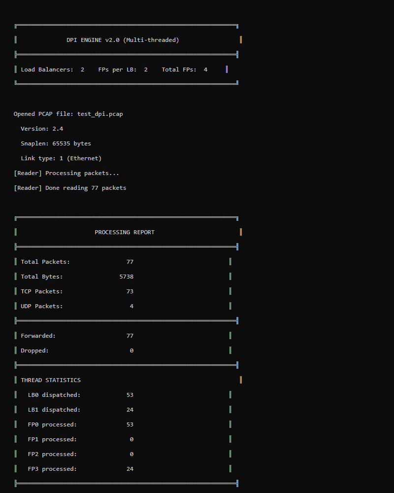
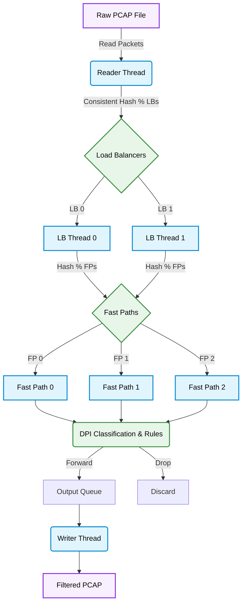

# DPI Engine

A C++17 packet analyzer that rebuilds TCP and UDP flows from PCAP captures and classifies traffic by TLS SNI and HTTP Host.



---

## Overview

DPI Engine is a high-performance deep packet inspection system written in C++17. It ingests standard PCAP packet captures, reconstructs stateful L4 TCP and UDP network flows, and inspects application-layer payloads. By parsing TLS Client Hello handshakes (SNI extraction) and cleartext HTTP Host headers, the engine accurately classifies encrypted HTTPS and web traffic and enforces configurable filtering policies (Drop or Forward) based on destination domain, IP address, or application category.

To scale across multi-core processors, the engine decouples raw packet I/O from deep flow inspection using a multi-threaded Load Balancer and Fast Path architecture with consistent 5-tuple hashing.

---

## Architecture Overview



Consistent hashing ensures that all packets belonging to the same TCP or UDP connection are routed deterministically to the same Fast Path worker thread, eliminating race conditions and avoiding lock contention on connection state tables.

---

## Features

| Feature | Description |
| ------- | ----------- |
| **Protocol Parsing** | Low-overhead zero-copy parsing of Ethernet (L2), IPv4 (L3), and TCP/UDP (L4) headers |
| **TLS SNI Extraction** | Deep inspection of TLS 1.2 and 1.3 Client Hello handshakes to extract Server Name Indication for encrypted flows |
| **Stateful Flow Tracking** | 5-tuple connection tables (`Src IP`, `Dst IP`, `Src Port`, `Dst Port`, `Protocol`) tracking TCP handshake states and packet counters |
| **Configurable Rule Firewall** | Rule evaluation supporting IP blacklists, domain substring matches, and high-level application categories |
| **Load Balanced Concurrency** | Dedicated Reader and Load Balancer threads dispatching to parallel Fast Path workers via lock-free or condition-variable bounded queues |
| **PCAP Generation Utilities** | Python test generators for synthetic multi-flow traffic with TLS and HTTP payloads |

---

## Technology Stack

| Component | Technology |
| --------- | ---------- |
| Language Standard | C++17 |
| Build System | CMake 3.16+ |
| Concurrency Primitives | `std::thread`, `std::mutex`, `std::condition_variable` |
| Test Harness | Python 3, scapy / custom socket generator |
| Binary Targets | `dpi_engine` (multi-threaded), `dpi_simple` (single-threaded) |

---

## Project Structure

```
DPI-Engine/
├── include/
│   ├── pcap_reader.h       # PCAP header and record structures
│   ├── packet_parser.h     # L2/L3/L4 protocol parsing headers
│   ├── sni_extractor.h     # TLS SNI and HTTP Host extraction
│   ├── platform.h          # Cross-platform endianness and networking macros
│   └── types.h             # FiveTuple, flow tracking models, and filter rules
├── src/
│   ├── dpi_mt.cpp          # Multi-threaded engine with Load Balancer and Fast Paths
│   ├── main_working.cpp    # Single-threaded reference implementation
│   ├── pcap_reader.cpp     # File parsing and validation
│   ├── packet_parser.cpp   # Network layer parsing logic
│   ├── sni_extractor.cpp   # L7 inspection routines
│   └── types.cpp           # IP formatting and application helpers
├── tests/
│   └── test_extractors.cpp # C++ extractor unit tests
├── CMakeLists.txt          # Build system configuration
├── generate_test_pcap.py   # Test PCAP generator script
└── README.md
```

---

## Setup and Installation

### Prerequisites

- C++17 compatible compiler (`g++`, `clang++`, or MSVC 2019+)
- CMake 3.16 or higher

### Build Instructions

```bash
git clone https://github.com/Shashank17singh/DPI-Engine.git
cd DPI-Engine

cmake -B build -DCMAKE_BUILD_TYPE=Release
cmake --build build
```

This compiles both the multi-threaded production binary (`build/dpi_engine`) and the reference single-threaded binary (`build/dpi_simple`).

---

## Usage

Analyze and filter a PCAP file:

```bash
./build/dpi_engine input.pcap output.pcap
```

### Filtering and Firewall Rules

Supply command-line flags to selectively drop or forward traffic:

```bash
./build/dpi_engine input.pcap output.pcap \
    --block-app YouTube \
    --block-app TikTok \
    --block-ip 192.168.1.50 \
    --block-domain facebook
```

### Worker Thread Tuning

Configure the number of Load Balancer (LB) and Fast Path (FP) threads:

```bash
# 4 Load Balancers and 8 Fast Paths (32 processing worker threads)
./build/dpi_engine input.pcap output.pcap --lbs 4 --fps 8
```

---

## Running the Tests

Generate synthetic test captures:

```bash
python generate_test_pcap.py
```

Run the extractor verification suite:

```bash
cmake -B build -DBUILD_TESTS=ON
cmake --build build
./build/test_extractors
```

Run static Python lint checks:

```bash
ruff check .
```

---

## Deployment

The compiled binaries are self-contained with no external runtime dependencies beyond libc and the standard C++ runtime. For containerized testing:

```bash
docker build -t dpi-engine -f Dockerfile .
docker run --rm -v $(pwd):/data dpi-engine /data/input.pcap /data/output.pcap
```

---

## Known Limitations

- IP fragmentation is currently reassembled only on contiguous segment arrivals; out-of-order IP fragments across jumbo frames require an extended fragment buffer.
- TLS 1.3 Encrypted Client Hello (ECH / ESNE) hides the SNI inside encrypted outer wrappers, requiring DNS or IP-based correlation for classification.

---

## License

This project is licensed under the MIT License. See [LICENSE](LICENSE) for details.
